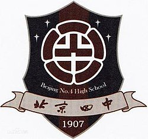








我叫**钮天乐**，高中毕业于北京市**北京四中**，本科就读于黑龙江哈尔滨**哈尔滨工业大学 未来技术学院**，预计2027年毕业。
我的本科专业排名为1/207，GPA：3.97/4.00，学分绩：95.732。

🤩 我的研究兴趣包括：

- MLLM
- 数据蒸馏
- 图像恢复

# 🎓 教育经历

- *2020.09 - 2023.06*, 北京四中
- *2023.09 - 2027.06*,  哈尔滨工业大学，计算机科学与技术专业，本科

# 📝 科研论文

arXiv

- **VideoCompressa: Data-Efficient Video Understanding via Joint Temporal Compression and Spatial Reconstruction**
  Shaobo Wang\*, `Tianle Niu`\*, Runkang Yang, Deshan Liu, Xu He, Zichen Wen, Conghui He, Xuming Hu, Linfeng Zhang
  *arXiv preprint*（共同一作）
  [[预览]](https://arxiv.org/abs/2511.18831)

AAAI 2026

- **ImageBindDC: Compressing Multi-Modal Data with ImageBind-Based Condensation**
  Yue Min, Shaobo Wang, Jiaze Li, `Tianle Niu`, Junxin Fan, Yongliang Miao, Lijin Yang, Linfeng Zhang
  *Proceedings of the AAAI Conference on Artificial Intelligence* (AAAI 2026)
  [[预览]](https://arxiv.org/abs/2511.08263)

ACL Findings 2026

- **MelTrim: Coarse-to-Fine Data Pruning for Speech Classification**
  Shaobo Wang\*, `Tianle Niu`\*, Xuan Ouyang\*, Xintong Li, Zhengkun Ge, Yue Min, Xiaoqian Liu, Hankun Wang, Linfeng Zhang
  *Findings of the Association for Computational Linguistics: ACL 2026*, San Diego, pp. 13751–13765（共同一作）
  [[论文]](https://aclanthology.org/2026.findings-acl.672/) [[PDF]](https://aclanthology.org/2026.findings-acl.672.pdf)

# 🏅 荣誉奖项

- *2025.04* 获得 中国移动第四届“梧桐杯”人工智能赛道全国 `亚军`
- *2025.05* 获得 美国大学生数学建模竞赛 (MCM/ICM) `M奖`
- *2024.11* 担任 大学生创新创业训练计划年会 `本科负责人`
- *2025.07* 获得 生命医学工程竞赛 国家级 `一等奖`
- *2025.07* 获得 全国大学生生命科学竞赛 国家级 `二等奖`
- *2024.12* 获得 高教杯全国大学生数学建模竞赛 省级 `一等奖`
- *2024.10* 获得 全国大学生创新创业产业赛道 `银奖`
- *2025.05* 获得 全国职业规划大赛 黑龙江省 `冠军`

